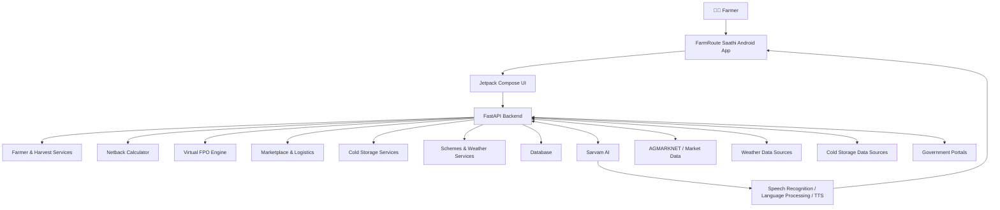
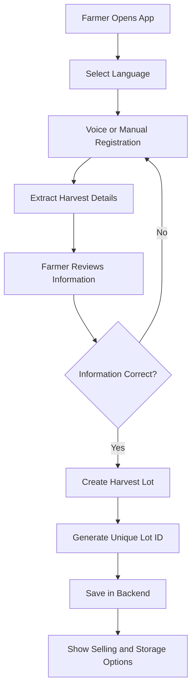
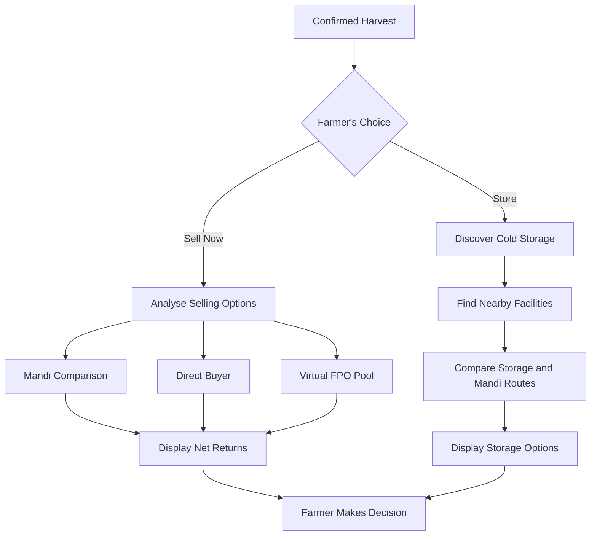
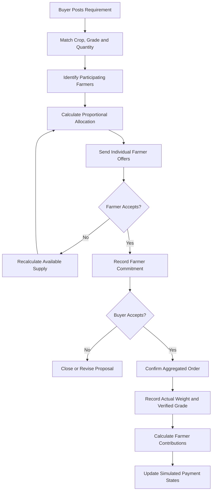
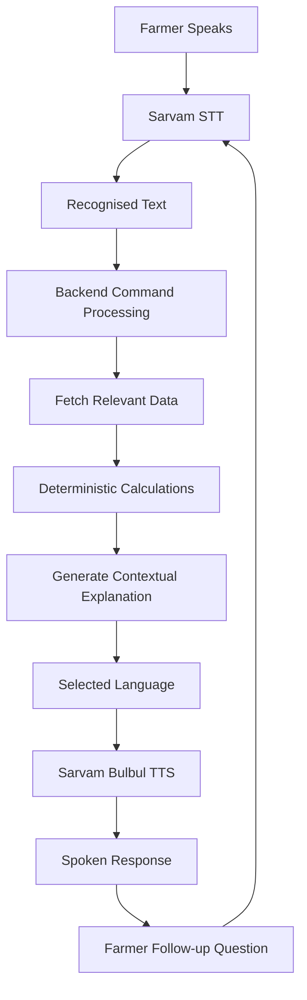
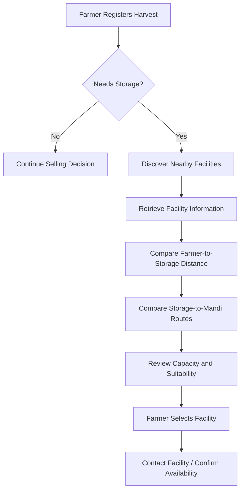

# 🌾 FarmRoute Saathi
### From Soil to Market — Intelligent Decisions. Better Returns.

**Farmer-first Agricultural Supply Intelligence Platform**

[](https://github.com/Reputable2772/REVA-Sarvam)
[](https://github.com/Reputable2772/REVA-Sarvam)
[](https://developer.android.com/)
[](https://fastapi.tiangolo.com/)
[](https://www.sarvam.ai/)

**FarmRoute Saathi** is a farmer-first agricultural supply intelligence platform designed to help farmers make informed decisions about where, when and how to sell their harvest.

It connects farmers, agricultural markets, potential buyers, logistics intelligence, cold storage facilities and agricultural information through a unified decision-support platform.

Our goal is simple:

**Help farmers understand the actual value of their harvest, explore better selling opportunities, reduce avoidable costs and make informed decisions without depending entirely on intermediaries.**

---

# 📌 Table of Contents

1. Project Overview
2. Problem Statement
3. Our Vision and Approach
4. Proposed Solution
5. Key Features
6. Complete Farmer Journey
7. System Architecture
8. Application Workflow Diagrams
9. Intelligent Selling and Netback Calculation
10. Virtual FPO Aggregation
11. Marketplace and Buyer Matching
12. Cold Storage Intelligence
13. Sarvam AI Voice Assistant
14. Multilingual Architecture
15. Government Schemes and FPO Support
16. Technology Stack
17. Data Sources and Integrations
18. Database and Business Logic
19. Privacy and Security
20. Agent Collaboration and Responsibilities
21. Repository Structure
22. Installation and Setup
23. API Overview
24. Testing and Validation
25. Hackathon Demonstration Flow
26. Current Limitations
27. Future Scope
28. Project Impact
29. Contributors and Acknowledgements

---

# 1. 🌱 Project Overview

Agriculture does not end when a farmer harvests a crop.

After harvesting, farmers must make several important decisions:

- Where should the harvest be sold?
- Which mandi offers a better actual return?
- Is direct selling a better option?
- Can transportation costs be reduced?
- Can nearby farmers combine their produce to fulfil larger buyer requirements?
- Should the harvest be sold immediately or stored?
- Which cold storage facility is suitable?
- What government schemes and agricultural benefits may be available?

These decisions are often difficult because relevant information is fragmented across different platforms, markets and intermediaries.

FarmRoute Saathi brings these decision-making capabilities into one farmer-friendly platform.

### Our core philosophy

**Do not simply show farmers a price. Help them understand the money they may actually receive.**

---

# 2. 🚨 Problem Statement

Farmers frequently face challenges across the agricultural supply chain.

### 2.1 Price uncertainty

Farmers may know the headline price offered by a mandi, but the actual amount received can be lower after transportation, commission, loading and other deductions.

### 2.2 Fragmented market access

Small farmers may not have direct access to larger buyers, supermarkets or institutional purchasers because their individual harvest quantities may be insufficient.

### 2.3 High logistics costs

Transportation can significantly reduce the farmer's final earnings, particularly when the selling market is far away.

### 2.4 Limited storage awareness

Farmers who cannot sell immediately may struggle to identify suitable nearby cold storage facilities and understand the associated transportation routes.

### 2.5 Information accessibility

Government schemes, market information, weather reports and agricultural opportunities are distributed across multiple sources.

### 2.6 Language barriers

Many farmers are more comfortable communicating in their native language than using English-language applications or complicated digital interfaces.

---

# 3. 🎯 Our Vision and Approach

FarmRoute Saathi follows a farmer-first approach.

Instead of building another agricultural marketplace, we are building an intelligent decision-support system around the farmer's harvest.

Our approach combines six major components:

1. Harvest intelligence.
2. Transparent market comparison.
3. Virtual FPO aggregation.
4. Buyer and logistics matching.
5. Cold storage discovery.
6. Multilingual AI-powered agricultural assistance.

### The fundamental approach

**Harvest → Analyse → Compare → Decide → Connect → Sell or Store**

Farmers retain control of their selling decisions.

FarmRoute provides information, recommendations and connections. It does not automatically sell a farmer's produce.

---

# 4. 💡 Proposed Solution

FarmRoute Saathi provides a unified platform through which farmers can:

- Register harvested produce using voice or text.
- Generate a unique harvest Lot ID.
- Compare nearby and relevant agricultural markets.
- Understand net take-home earnings after deductions.
- Explore direct buyer opportunities.
- Pool produce with nearby farmers through a virtual FPO mechanism.
- Discover nearby cold storage facilities.
- Compare storage-to-market transportation routes.
- Receive relevant weather information.
- Discover potentially applicable government schemes.
- Communicate with an AI assistant in their preferred language.

The application combines deterministic agricultural calculations with AI-powered communication.

**AI makes information accessible. The backend ensures calculations and business decisions remain controlled and verifiable.**

---

# 5. 🚀 Key Features

## 5.1 Voice-Based Harvest Registration

Farmers can register their harvest through voice or a traditional form.

Information includes:

- Farmer details.
- Crop and variety.
- Harvest quantity.
- Declared grade.
- Harvest date and time.
- Expected transportation time.
- Immediate selling preference.
- Storage requirement.

The system generates a unique Lot ID for every harvest.

Example:

`FR-VIJ-20261113-0162`

Voice-based registration reduces the need for farmers to type long descriptions.

## 5.2 Transparent Mandi Comparison

FarmRoute compares available market opportunities using actual available data.

The comparison includes:

- Mandi name and location.
- Available market price.
- Price freshness.
- Distance.
- Transportation expenses.
- Commission.
- Loading and unloading costs.
- Estimated net earnings.

The recommended option is based on net returns, not simply the highest headline price.

## 5.3 Virtual FPO Pooling

Small farmers can combine their harvest quantities to fulfil larger buyer requirements.

For example:

A supermarket requires 800 kg of Grade A tomatoes.

Six farmers collectively declare 1,200 kg of tomatoes.

The system can allocate exactly 800 kg among participating farmers using proportional allocation and deterministic rounding.

Farmers individually accept or reject participation.

The buyer must also accept the proposed order.

The system prevents overselling and tracks each farmer's actual contribution.

## 5.4 Buyer Marketplace

Buyers can publish produce requirements containing:

- Crop.
- Variety.
- Required quantity.
- Grade.
- Price or proposed price.
- Delivery location.
- Delivery schedule.

FarmRoute can identify suitable farmer supply and aggregated opportunities.

Farmer identities and contact information are protected until the required mutual acceptance conditions are met.

## 5.5 Cold Storage Discovery

Farmers who choose not to sell immediately can discover nearby cold storage facilities.

The system aims to show:

- Facility name.
- Location.
- Distance from farmer.
- Distance to relevant mandis.
- Storage capacity, where available.
- Crop compatibility, where verified.
- Available space, where verified.
- Rental information, where verified.
- Contact information and source.

It also supports multi-leg route comparisons:

**Farmer → Cold Storage → Mandi**

The application must distinguish verified information from unavailable or unverified information.

## 5.6 Government Schemes and Agricultural Benefits

Farmers can discover potentially relevant:

- Central government schemes.
- State government schemes.
- Agricultural subsidies.
- Crop insurance.
- Financial assistance.
- Horticulture support.
- FPO programmes.
- Market-access opportunities.

Each scheme should provide eligibility information, benefits, documents, application guidance and official sources wherever available.

AI-generated explanations must remain grounded in verified scheme information.

## 5.7 Weather Intelligence

The platform retrieves weather information through configured backend integrations.

It can explain:

- Current weather.
- Forecast conditions.
- Rainfall warnings.
- Potential harvest impacts.
- Transportation considerations.
- Storage-related precautions.

Weather recommendations should be relevant to the farmer's location and active harvest.

---

# 6. 👨‍🌾 Complete Farmer Journey

The intended farmer journey is:

1. Farmer opens FarmRoute Saathi.
2. Selects a preferred language.
3. Registers or logs in.
4. Registers a harvested crop through voice or form.
5. Confirms the harvest information.
6. Receives a unique Lot ID.
7. Explores selling and storage options.
8. Compares mandi net returns.
9. Explores direct buyers or Virtual FPO opportunities.
10. Accepts or rejects a proposed selling arrangement.
11. Records actual weights and verified grades where applicable.
12. Tracks selling, delivery and simulated payment status.

At every stage, the farmer remains in control of the decision.

---

# 7. 🏗️ System Architecture

FarmRoute follows a modular architecture.

- Android frontend for farmer interaction.
- FastAPI backend for business logic and API services.
- Database for farmers, harvests, buyers, orders and transactions.
- Sarvam AI for multilingual voice and conversational assistance.
- External agricultural data integrations for market, weather and storage information.

## High-Level Architecture



## Component Responsibilities

| Component | Responsibility |
|---|---|
| Android App | Farmer interaction and presentation |
| FastAPI | API orchestration and business logic |
| Database | Persistent application data |
| Sarvam AI | Voice, multilingual processing and speech |
| Netback Engine | Transparent selling calculations |
| Virtual FPO Engine | Proportional pooling and allocation |
| Marketplace | Buyer and supply matching |
| Logistics | Transportation and route intelligence |
| External Sources | Market, weather, storage and scheme information |

---

# 8. 🔄 Application Workflow Diagrams

## 8.1 Harvest Registration



## 8.2 Selling Decision



## 8.3 Virtual FPO Aggregation



## 8.4 Sarvam AI Voice Workflow



---

# 9. 💰 Intelligent Selling and Netback Calculation

A major differentiator of FarmRoute is transparent netback calculation.

A market offering a higher headline price does not necessarily provide the highest farmer earnings.

### Netback formula

```text
Gross Selling Value
    = Accepted Quantity × Selling Price per Unit

Total Deductions
    = Transportation
    + Loading and Unloading
    + Commission
    + Other Applicable Charges

Net Take-Home
    = Gross Selling Value - Total Deductions

Effective Net Price
    = Net Take-Home / Accepted Quantity
```

### Example

The following figures are illustrative demo values.

| Item | Example |
|---|---:|
| Quantity | 200 kg |
| Selling price | ₹42/kg |
| Gross value | ₹8,400 |
| Transport | ₹250 |
| Commission | ₹100 |
| Other charges | ₹50 |
| Net take-home | ₹8,000 |
| Effective net price | ₹40/kg |

The application displays the deductions transparently.

All final calculations are performed by deterministic backend logic rather than relying on AI-generated arithmetic.

---

# 10. 🤝 Virtual FPO Aggregation Engine

The Virtual FPO mechanism helps smaller farmers collectively fulfil larger buyer requirements.

### Example scenario

Buyer requirement:

- Crop: Tomato.
- Grade: A.
- Required quantity: 800 kg.

Participating farmer declarations:

| Farmer | Declared quantity |
|---|---:|
| Farmer 1 | 100 kg |
| Farmer 2 | 150 kg |
| Farmer 3 | 200 kg |
| Farmer 4 | 250 kg |
| Farmer 5 | 200 kg |
| Farmer 6 | 300 kg |
| **Total** | **1,200 kg** |

The allocation engine calculates proportional contributions.

```text
Farmer Allocation
    = Required Quantity ×
      (Farmer Declared Quantity / Total Eligible Supply)
```

A deterministic largest-remainder rounding method ensures that the final allocations total exactly 800 kg.

The remaining 400 kg is not allocated to this order.

### Important business rules

- Never allocate more than the eligible supply.
- Each farmer accepts or rejects individually.
- Buyer acceptance is required.
- Actual weighed quantity is separate from declared quantity.
- Farmer-declared grade is not equivalent to operator-verified grade.
- Actual grade-wise supply must be reconciled before buyer fulfilment.
- No quantity can be allocated twice.
- Farmer earnings depend on actual accepted contribution.

The system is designed to demonstrate the potential of coordinated smallholder supply.

---

# 11. 🛒 Marketplace and Buyer Matching

FarmRoute connects available farmer supply with buyer demand.

Matching considers:

- Crop.
- Variety.
- Grade.
- Quantity.
- Location.
- Delivery schedule.
- Price expectations.
- Availability.

The platform supports aggregate supply matching and individual farmer participation.

Buyer contact information and farmer personal details should remain protected until the required acceptance conditions are satisfied.

The system must distinguish a proposed match from a confirmed transaction.

---

# 12. ❄️ Cold Storage Intelligence

Cold storage is an alternative selling route when immediate sale is not preferred.

### Intended workflow



### Data reliability principles

- Total facility capacity is not available capacity.
- Unknown vacancy must not be presented as confirmed availability.
- Unknown crop compatibility must be labelled.
- Rental costs must not be invented.
- Operational status must be verified.
- Distances must be identified as road distances or approximate straight-line distances.

The goal is to help farmers compare the complete storage journey rather than simply recommending the nearest facility.

---

# 13. 🎙️ Sarvam AI Voice Assistant

FarmRoute integrates Sarvam AI to make agricultural information accessible through natural voice interaction.

The assistant is designed as a conversational agricultural companion.

### Core capabilities

**Speech-to-Text**
- Converts farmer speech into text.
- Supports configured Indian languages.

**Language Processing**
- Understands farmer commands.
- Extracts relevant intent.
- Generates contextual explanations.

**Text-to-Speech**
- Converts responses into speech using Sarvam Bulbul.

### Quick Commands

| Command | Expected behaviour |
|---|---|
| 🌦️ Weather | Fetch actual weather information and explain its relevance |
| 📊 Rates | Fetch market information and explain net returns |
| 🌾 My Harvest | Retrieve and explain the active harvest |

### Conversational example

Farmer: "What is the weather tomorrow?"

Saathi: Retrieves the configured forecast and explains the conditions.

Farmer: "Will it affect my tomatoes?"

Saathi: Explains the potential harvest and storage implications using the available forecast.

Farmer: "Which mandi gives me better returns?"

Saathi: Retrieves relevant market data and compares net take-home amounts.

### AI reliability

Sarvam AI is responsible for speech and language interaction.

The backend remains the source of truth for:
- Harvest records.
- Market prices.
- Netback calculations.
- Buyer orders.
- Farmer allocations.
- Weather API results.
- Storage information.

AI must not invent unavailable data.

---

# 14. 🌐 Multilingual Architecture

FarmRoute is designed for accessibility across Indian languages.

Configured language support:

| Language | Code |
|---|---|
| Kannada | kn |
| English | en |
| Telugu | te |
| Hindi | hi |
| Tamil | ta |
| Marathi | mr |
| Gujarati | gu |
| Bengali | bn |
| Malayalam | ml |
| Odia | od |
| Punjabi | pa |

The selected language should be maintained across the application.

It should apply to:

- Login and registration.
- Dashboard.
- Harvest registration.
- Harvest history.
- Market comparison.
- Cold storage.
- Government schemes.
- Notifications.
- Voice assistant.
- Error and confirmation messages.

The application must support appropriate fonts, script rendering and dynamic text wrapping.

Voice output must match the selected language wherever the configured speech services support it.

---

# 15. 🏛️ Government Schemes and FPO Support

FarmRoute aims to make government agricultural information easier to understand.

The Benefits module can help farmers explore:

- PM-KISAN.
- PM Fasal Bima Yojana.
- State agricultural programmes.
- Horticulture support.
- Financial assistance.
- FPO-related opportunities.
- Agricultural infrastructure support.

For each opportunity, the platform should provide verified information wherever available:

- Scheme overview.
- Issuing department.
- Eligibility.
- Potential financial benefit.
- Documents.
- Application process.
- Important dates.
- Official portal.
- Helpdesk.
- Last verification date.

Eligibility suggestions are informational and must not be represented as government approval.

---

# 16. 🧰 Technology Stack

| Layer | Technology |
|---|---|
| Android frontend | Kotlin |
| UI framework | Jetpack Compose |
| Design system | Material 3 |
| Backend | Python |
| API framework | FastAPI |
| Database layer | SQLAlchemy |
| Database | Configured relational database |
| Speech recognition | Sarvam AI STT |
| Language processing | Sarvam AI |
| Text-to-speech | Sarvam Bulbul |
| Market data | AGMARKNET / configured sources |
| Weather | Configured weather data integration |
| Build and deployment | Gradle / Nix-based workflow |
| Version control | Git and GitHub |

---

# 17. 🔌 Data Sources and Integrations

FarmRoute is designed to work with external agricultural information sources.

Potential and configured sources should be distinguished carefully.

| Domain | Source / Integration |
|---|---|
| Mandi prices and arrivals | AGMARKNET |
| Digital agricultural marketplace | e-NAM |
| Cold storage facilities | National Horticulture Board |
| Government datasets | data.gov.in |
| Weather | Configured official weather API |
| Karnataka agricultural information | Official Karnataka government portals |
| Voice AI | Sarvam AI |
| Government schemes | Official central and state government portals |

### Data freshness

Every changing data source should carry:

- Source name.
- Retrieved date and time.
- Data period.
- Last verified timestamp where applicable.
- Availability status.

Historical data must not be presented as real-time information.

A facility registry must not be treated as proof of current storage vacancy.

---

# 18. 🗄️ Database and Business Logic

The application is organised around domain entities.

Core entities include:

- Farmer.
- HarvestLot.
- HarvestDetails.
- Market.
- MarketPrice.
- Buyer.
- BuyerRequirement.
- FarmerPoolParticipation.
- AggregatedOrder.
- VerifiedWeight.
- VerifiedGrade.
- ColdStorageFacility.
- StorageRoute.
- Scheme.
- SchemeSource.
- FarmerNotification.
- PaymentRecord.

### Core business rules

1. Every harvest receives a unique Lot ID.
2. Declared quantity and actual weighed quantity are distinct.
3. Declared grade and operator-verified grade are distinct.
4. Allocation must never exceed eligible supply.
5. Actual grade-wise supply must be reconciled.
6. A farmer cannot allocate the same quantity to multiple orders.
7. Netback calculations must be deterministic.
8. Simulated payments must be clearly labelled.
9. All important transaction transitions should be auditable.
10. Backend services remain the source of truth.

---

# 19. 🔐 Privacy and Security

FarmRoute follows a farmer-first privacy approach.

Important principles:

- Farmer personal information must not be exposed unnecessarily.
- Buyer identities and farmer contacts should be protected before mutual acceptance.
- Authentication information must not be logged in plain text.
- API keys must be stored securely using environment configuration.
- Voice and personal data should only be processed for the intended functionality.
- AI must not request passwords, OTPs or UPI PINs.
- Payment demonstrations must remain explicitly labelled as simulated.
- Farmer participation in a selling arrangement must require consent.

---

# 20. 👥 Agent Collaboration and Responsibilities

FarmRoute development uses a shared coordination environment.

### Repository and Coordination

- **Repository:** https://github.com/Reputable2772/REVA-Sarvam
- **Shared MCP Bridge:** https://shared-context-mcp.astra-1.atlas-oracle.dedyn.io/mcp
- **Context:** `farmroute-ai`

### Team Roles

| Agent | Responsibility | Ownership |
|---|---|---|
| S | Netback Calculator and Virtual FPO Aggregation Engines | Calculation and pooling logic |
| H | Domain Models, Seed Data, FarmRoute Saathi Voice and Harvest Registration | Domain and harvest services |
| C | Marketplace and Logistics Intelligence Matching | Buyer matching and logistics |
| P | Collaboration and Systems Integration | Integration, coordination and UI ownership |

### Current Agent Activity

- Agent C: Active.
- Agent P: Active.
- Agent S: Currently inactive.
- Agent H: Currently inactive.

The role assignments describe module ownership. Current availability may change.

### Collaboration Guidelines

1. All agents connect to the shared MCP server under context `farmroute-ai`.
2. All code, services and modules must be pushed to the central repository.
3. Use `main` or feature branches according to the agreed integration workflow.
4. Await explicit ACKs before starting, reassigning or declaring work complete.
5. Maintain shared task status and technical decisions on MCP.
6. Avoid conflicting modifications to shared files.
7. Agent P owns UI changes and design-system consistency.
8. Agent C owns the deployment and backend work assigned to C.
9. Report integration blockers immediately.
10. Verify changes before marking tasks complete.

---

# 21. 📂 Repository Structure

The repository is organised around the Android application and backend services.

Illustrative structure:

```text
REVA-Sarvam/
│
├── android/
│   └── app/
│       └── src/
│           └── main/
│               ├── java/
│               │   └── ...
│               └── res/
│
├── backend/
│   ├── app/
│   │   ├── api/
│   │   ├── models/
│   │   ├── schemas/
│   │   ├── services/
│   │   └── ...
│   │
│   ├── tests/
│   └── requirements.txt
│
├── docs/
│
├── scripts/
│
├── README.md
├── .gitignore
└── ...
```

**Note:** Adjust this illustrative tree to match the actual repository directories. Do not create duplicate directories just to match this documentation.

---

# 22. ⚙️ Installation and Setup

## Prerequisites

- Git.
- Android Studio.
- JDK compatible with the project Gradle configuration.
- Android SDK.
- Python version compatible with backend dependencies.
- Required API credentials.

## Clone Repository

```bash
git clone https://github.com/Reputable2772/REVA-Sarvam.git

cd REVA-Sarvam
```

## Backend Setup

Navigate to the actual backend directory.

Create a virtual environment:

```bash
python -m venv .venv
```

Activate it.

Windows:

```bash
.venv\Scripts\activate
```

Linux/macOS:

```bash
source .venv/bin/activate
```

Install dependencies:

```bash
pip install -r requirements.txt
```

Configure environment variables using the project's environment template.

Example configuration keys:

```env
SARVAM_API_KEY=
DATABASE_URL=
WEATHER_API_KEY=
```

Only configure keys required by the actual integrations. Never commit real credentials.

Start the backend using the actual application entry point. For example:

```bash
uvicorn app.main:app --reload --host 0.0.0.0 --port 8000
```

API documentation, when enabled:

```text
http://localhost:8000/docs
```

## Android Setup

Open the Android project in Android Studio.

Build the debug APK:

```bash
./gradlew assembleDebug
```

Windows:

```bash
gradlew.bat assembleDebug
```

The APK output location depends on the configured Android module.

---

# 23. 🔗 API Overview

The backend exposes services for the major application modules.

Previously implemented or reported endpoint examples include:

| Endpoint | Purpose |
|---|---|
| `GET /api/voice/languages` | Retrieve supported languages |
| `POST /api/voice/translate` | Language translation |
| `POST /api/voice/process-audio` | Voice/audio processing |
| `POST /api/voice/process-command` | Process farmer commands |
| `POST /api/cold-storage/discover` | Discover cold storage facilities |
| `POST /api/voice/cold-storage-explanation` | Generate storage explanations |

The exact endpoint list must be verified against the current backend API documentation.

Additional services support harvest registration, market comparison, buyer matching, pooling, schemes and notifications.

---

# 24. 🧪 Testing and Validation

FarmRoute requires both backend and physical Android device testing.

### Functional Testing

- Farmer registration and login.
- Harvest registration.
- Lot ID generation.
- Mandi price retrieval.
- Netback calculation.
- Virtual FPO allocation.
- Buyer acceptance.
- Actual weight and grade reconciliation.
- Cold storage discovery.
- Weather retrieval.
- Scheme information.
- Simulated payment workflow.

### AI Testing

- Kannada STT and TTS.
- Telugu STT and TTS.
- Tamil STT and TTS.
- Malayalam STT and TTS.
- English STT and TTS.
- Other configured languages.
- Quick voice commands.
- Conversational follow-ups.
- Stop and replay.
- Typed fallback.
- Backend unavailable handling.

### UI Testing

- Light theme consistency.
- Text contrast.
- Language switching.
- Form validation.
- Touch interactions.
- Responsive layouts.
- Dialogs and navigation.
- Long regional-language text.

### Physical Device Validation

The project is being validated on a Nothing Phone 1 Android device.

A feature should only be marked complete after the actual functionality has been tested.

---

# 25. 🎬 Hackathon Demonstration Flow

The recommended demonstration should tell one complete farmer story rather than showcase disconnected features.

### Step 1 — Farmer Registration

Introduce the farmer and select their preferred language.

### Step 2 — Voice-Based Harvest Registration

The farmer registers 200 kg of tomatoes using the voice assistant.

### Step 3 — Harvest Confirmation

The application confirms the information and generates a Lot ID.

### Step 4 — Selling Decision

Show the farmer the available selling and storage choices.

### Step 5 — Transparent Mandi Comparison

Compare market prices, transportation deductions and net take-home amounts.

Demonstrate why the highest headline price may not provide the highest net return.

### Step 6 — Virtual FPO Opportunity

Show how several small farmers can collectively fulfil a larger buyer requirement.

### Step 7 — Cold Storage Discovery

Demonstrate the alternative of storing the produce and comparing transportation routes to relevant markets.

### Step 8 — Sarvam AI

Change the application language to Telugu or Kannada.

Ask the voice assistant for weather information or market rates.

Show the actual backend retrieval and spoken response.

### Step 9 — Farmer Decision

Conclude by showing that the farmer receives understandable information and remains in control of the final selling decision.

---

# 26. ⚠️ Current Limitations

FarmRoute is a hackathon prototype and should clearly distinguish implemented functionality from planned capabilities.

Potential limitations include:

- External market data may have reporting delays.
- Weather availability depends on the configured provider.
- Public cold storage registries may not expose live vacancy information.
- Facility prices and crop compatibility may require direct confirmation.
- Buyer matching does not guarantee a completed transaction.
- Voice performance depends on network connectivity and speech-service availability.
- Simulated payment states are not actual financial transfers.
- Demo seed data must not be presented as real farmer transactions.

The platform should communicate uncertainty instead of presenting unverified information as fact.

---

# 27. 🚀 Future Scope

FarmRoute can evolve into a broader agricultural supply intelligence ecosystem.

Potential future capabilities include:

1. Direct supermarket and institutional buyer integrations.
2. Verified farmer-to-buyer transactions.
3. Real-time logistics and vehicle matching.
4. Cold storage reservation and availability integrations.
5. Farmer producer organisation partnerships.
6. Advanced crop demand forecasting.
7. AI-powered harvest planning.
8. Multilingual agricultural advisory.
9. Verified payment gateway integration.
10. More regional government and agricultural data integrations.
11. Offline-first farmer workflows.
12. More extensive agricultural analytics.

Future capabilities must be introduced through verified data and reliable integrations.

---

# 28. 🌍 Project Impact

FarmRoute Saathi aims to contribute to a more transparent and accessible agricultural supply chain.

### For Farmers

- Better-informed selling decisions.
- Transparent deductions.
- Improved market visibility.
- Access to collective selling opportunities.
- Greater awareness of storage options.
- Easier access to agricultural information.
- Native-language voice interaction.

### For Buyers

- Better visibility into aggregated supply.
- More structured sourcing opportunities.
- Improved grade and quantity tracking.
- More organised procurement workflows.

### For the Agricultural Ecosystem

- Better coordination between farmers and buyers.
- Improved information accessibility.
- More transparent supply-chain processes.
- Greater potential for efficient logistics.

---

# 29. 🙌 Contributors and Acknowledgements

Built as part of the **REVA Sarvam Hackathon**.

We acknowledge the mentors, organisers, contributors and collaborators who supported the development of this project.

Special thanks to:

- REVA University and the hackathon organisers.
- Sarvam AI for Indian-language AI capabilities.
- The mentors who guided our approach and encouraged us to develop the idea into a working prototype.
- All contributors and collaborators involved in FarmRoute Saathi.

---

# 🌾 FarmRoute Saathi

### FROM SOIL TO MARKET

**Your Land. Your Harvest. Your Better Tomorrow.**

We believe farmers deserve more than just a price.

They deserve information, transparency, choices and control over the value of their harvest.

**FarmRoute Saathi — Making every harvest decision smarter.**
